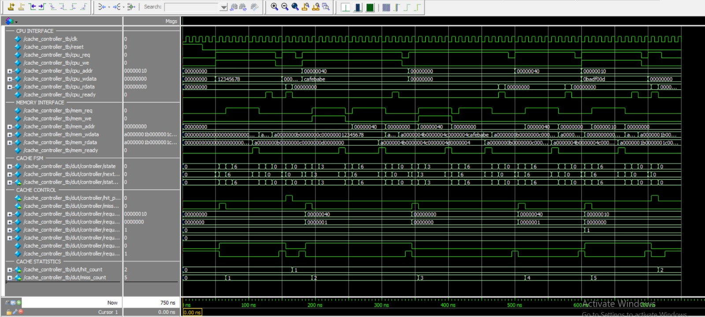

# L1-Cache-Controller
A Verilog HDL-based L1 Cache Controller implementing high-speed data access between a processor and main memory. The project focuses on cache operations, address decoding, hit/miss detection, and memory access control to reduce average memory access latency. Verified using a Verilog testbench and ModelSim simulation.
# L1 Cache Controller Design using Verilog HDL

**A 64-Byte Direct-Mapped L1 Cache Controller with Write-Back and Write-Allocate Policies**


---

## About the Project

This project implements a **64-byte Direct-Mapped L1 Cache Controller** using Verilog HDL. The cache controller acts as an interface between the processor and main memory, reducing average memory access latency by storing frequently accessed data in faster cache memory.

The design implements write-back and write-allocate policies and uses a modular architecture consisting of seven RTL modules. An FSM-based controller manages cache lookup, hit/miss detection, dirty line replacement, write-back, and cache refill operations.

The design is functionally simulated and verified using ModelSim.

## Cache Architecture

| Parameter | Specification |
|---|---|
| Cache Type | Direct-Mapped |
| Cache Capacity | 64 Bytes |
| Number of Cache Lines | 4 |
| Words per Cache Line | 4 |
| Word Size | 32 Bits |
| Cache Line Size | 128 Bits |
| Write Policy | Write-Back |
| Write Miss Policy | Write-Allocate |
| Valid Bit | 1 per cache line |
| Dirty Bit | 1 per cache line |

## Key Features

- Direct-mapped cache organization.
- Cache hit and miss detection.
- Address decoding using tag, index, and offset.
- Tag comparison for cache lookup.
- Processor read and write request handling.
- Write-back mechanism for dirty cache lines.
- Write-allocate mechanism during write misses.
- Cache line refill from main memory.
- Valid bit and dirty bit management.
- Hit and miss counters.
- FSM-based cache control.
- Modular RTL architecture using seven Verilog modules.

## Architecture and RTL Modules

The project is divided into seven RTL modules:

| RTL Module | Description |
|---|---|
| `cache_top.v` | Top-level integration of all cache modules. |
| `cache_controller.v` | Controls processor requests and cache operations. |
| `cache_fsm.v` | Implements the finite state machine for cache control. |
| `cache_tag_array.v` | Stores cache tags, valid bits, and dirty bits. |
| `cache_data_array.v` | Stores cache line data. |
| `cache_address_decoder.v` | Extracts tag, index, and offset from the address. |
| `cache_counter.v` | Maintains cache hit and miss counters. |

## Cache Operations

### 1. Cache Read Hit
- Processor sends a read request.
- Controller checks the valid bit and compares the requested tag.
- If the tag matches, the requested data is returned to the processor.
- Hit counter is incremented.

### 2. Cache Read Miss
- Controller detects a cache miss.
- If the selected cache line is dirty, its contents are written back to main memory.
- Required cache line is fetched from main memory.
- Cache tag and status bits are updated.
- Pending processor request is serviced.

### 3. Cache Write Hit
- Requested cache data is updated.
- Dirty bit is set.
- Main memory is not immediately updated because the design uses a write-back policy.

### 4. Cache Write Miss
- Required cache line is fetched from main memory.
- Processor write operation is applied to the allocated cache line.
- Dirty bit is set.

## Project Directory Structure

```text
L1_Cache_Controller/
│
├── RTL/
│   ├── cache_top.v
│   ├── cache_controller.v
│   ├── cache_fsm.v
│   ├── cache_tag_array.v
│   ├── cache_data_array.v
│   ├── cache_address_decoder.v
│   └── cache_counter.v
│
├── Testbench/
│   ├── cache_controller_tb.v
│   └── simple_memory.v
│
├── Simulation/
│   └── run.do
│
├── Waveforms/
│   └── l1_cache_controller_waveform.png
│
└── README.md
```

## Simulation and Verification

The design is simulated using ModelSim with a Verilog testbench and a simple main memory model.

The testbench verifies the following operations:

- Cache reset and initialization.
- Cache read hit.
- Cache read miss.
- Cache write hit.
- Cache write miss.
- Dirty cache line replacement.
- Write-back to main memory.
- Cache line refill.
- Read-after-write behavior.
- Hit and miss counter updates.

## Simulation Waveform

The following waveform shows the functional simulation of the L1 Cache Controller in ModelSim.

### ModelSim Simulation

The waveform is organized into the following sections:

**1. CPU Interface**
- Clock and reset.
- CPU read and write requests.
- CPU address and write data.
- CPU read data and ready signals.

**2. Memory Interface**
- Memory request and write enable.
- Memory address.
- Memory write data and read data.
- Memory ready signal.

**3. Cache FSM**
- Current state.
- Next state.
- State transitions during cache operations.

**4. Cache Control**
- Cache hit and miss detection.
- Request handling.
- Cache control signals.

**5. Cache Statistics**
- Cache hit counter.
- Cache miss counter.



## How to Run the Project

### Step 1: Create Working Library

```tcl
vlib work
```

### Step 2: Compile RTL Modules

```tcl
vlog RTL/cache_address_decoder.v
vlog RTL/cache_tag_array.v
vlog RTL/cache_data_array.v
vlog RTL/cache_counter.v
vlog RTL/cache_fsm.v
vlog RTL/cache_controller.v
vlog RTL/cache_top.v
```

### Step 3: Compile Testbench and Memory Model

```tcl
vlog Testbench/simple_memory.v
vlog Testbench/cache_controller_tb.v
```

### Step 4: Start Simulation

```tcl
vsim work.cache_controller_tb
```

### Step 5: Add Waveforms and Run

```tcl
add wave -r /*
run -all
```

Alternatively, execute the simulation script:

```tcl
do Simulation/run.do
```

## Tools and Technologies

- **Verilog HDL** – RTL design and implementation.
- **ModelSim** – Functional simulation and waveform analysis.
- **Finite State Machines** – Cache controller sequencing and control.
- **Digital Logic Design** – Cache storage and control logic.
- **Git and GitHub** – Version control and project documentation.

## Learning Outcomes

- Understanding L1 cache architecture and memory hierarchy.
- Implementing direct-mapped cache organization.
- Designing cache hit and miss detection logic.
- Understanding write-back and write-allocate policies.
- Developing FSM-based cache control logic.
- Writing modular and reusable Verilog RTL.
- Performing functional verification using ModelSim.
- Debugging hardware behavior through waveform analysis.

---

**Project Domain:** VLSI | RTL Design | Verilog HDL | Computer Architecture
